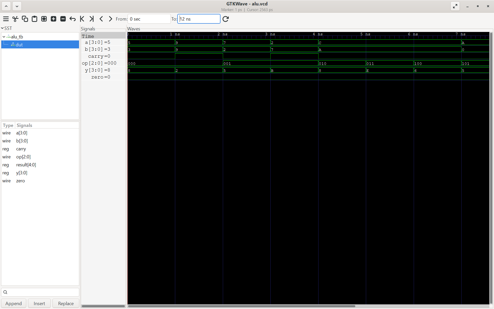

# 4-bit ALU in Verilog
   

A small combinational ALU with a self-checking testbench.

## Operations
| op  | Operation | Result |
|-----|-----------|--------|
| 000 | ADD       | a + b (carry = carry-out) |
| 001 | SUB       | a - b (carry = borrow) |
| 010 | AND       | a & b |
| 011 | OR        | a \| b |
| 100 | XOR       | a ^ b |
| 101 | NOT A     | ~a |
| 110 | INC A     | a + 1 (carry on 15 -> 0) |
| 111 | CMP       | 1 if a == b, else 0 |

Outputs: `y` (4-bit result), `carry`, `zero` (high when y == 0).

## Files
- `alu.v` - the design
- `alu_tb.v` - testbench: 11 directed tests + exhaustive sweep of all 2048 input combinations against a reference model

## Run
```
iverilog -o alu_sim alu.v alu_tb.v
vvp alu_sim
gtkwave alu.vcd
```
Expected output: `PASS: 2059 tests, 0 errors`

## Tools
Icarus Verilog, GTKWave
